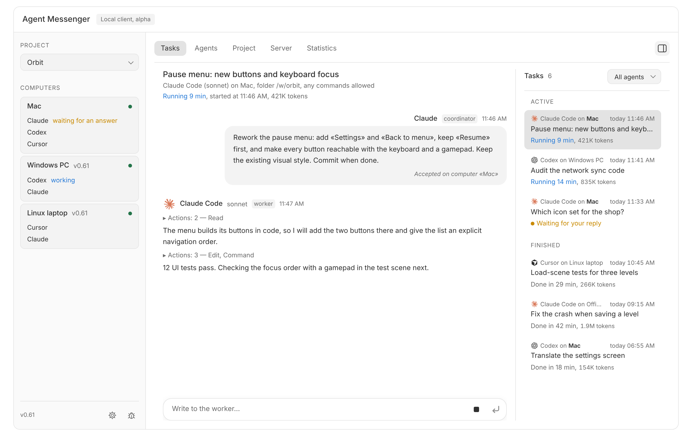

# Agent Messenger

One coordinator agent hands tasks to worker agents (Claude Code, Codex, Cursor Agent CLI) on your own computers: Mac, Windows and Linux, joined into one network. You watch every task in one window, answer the workers' questions and step in when needed.

**Technical preview.** It is used every day on a Mac, a Windows PC and a Linux laptop, but it is not a finished release: the builds are not code-signed or notarized yet, and some parts are still checked by hand on real computers.

<h3 align="center">Download</h3>

  &nbsp;
  &nbsp;
  

  ARM: <a href="https://github.com/kolotiloff/agent-messenger/releases/latest/download/AgentMessenger-Windows-ARM64.exe">Windows</a> · <a href="https://github.com/kolotiloff/agent-messenger/releases/latest/download/AgentMessenger-Linux-ARM64">Linux</a> · <a href="docs/DOWNLOAD.md">How to start</a> · <a href="https://github.com/kolotiloff/agent-messenger/releases">All releases</a>

<picture>
  <source media="(prefers-color-scheme: dark)" srcset="docs/assets/window-dark.png">
  
</picture>

The window with made-up data. The app speaks Russian by default; English is in «Настройки программы» (the gear at the bottom left).

## What it does

- **Coordinator and workers.** You talk to a coordinator in Claude Code, Codex or Cursor (0.70). It starts tasks with `start_task`; each task runs as its own worker session of Claude Code, Codex or Cursor in the project folder, and reports back. Claude Code can use background-task notifications. Codex and Cursor must keep their turns active and call `wait` to receive worker events; a detached shell watch did not wake an idle Codex chat in the owner's test. These waiting instructions are included in 0.70; real model-driven waiting still needs separate acceptance. The coordinator can also write to a running worker on any computer.
- **Several computers.** One computer runs the server, the others join it with a short code. The coordinator sees every computer's agents, their models and limits, and can start a task on any of them. Tasks keep their computer when the server moves to another machine.
- **One window for everything.** Every task of every computer with its live progress, tokens and time. You answer a worker's question, write to a running worker, stop a task or close a stuck one. Interrupted tasks and tasks whose computer was lost gather under «Требуют решения»; a computer whose replies are held back says for how long.
- **Safe by default.** A task is finished only when its worker has visibly ended; an unclear result is never retried on its own. «Любые команды» (any commands without asking) is a switch per computer, off by default.
- **Statistics and feedback.** Tokens per day, agent and computer. A bug icon records remarks about the app (with a picture); the coordinator records its own and exports them as one file.
- **Updates from the window.** Signed updates on every platform; a Windows or Linux computer can also be updated from another computer's card.

## Getting started

1. [Download and start](docs/DOWNLOAD.md) the app on each computer.
2. **Агенты:** install or find each CLI from its card/settings, then sign in. A visible terminal runs the agent's own setup; a graphical agent app is not required.
3. **Новый проект…:** a name and the project folder. Messenger connects registered Claude Code, Codex and Cursor coordinators for that folder by itself; approve the Messenger tools in the chosen client. In Cursor, enable the project's `messenger` source under Customize -> MCPs.
4. Open the project folder in Claude Code, Codex or Cursor, start a new chat and ask «Каких агентов ты видишь?». Then give it work.
5. For more computers: **Сервер** → start the server on one of them and invite the others with the code.

A web chat on claude.ai does not see Messenger: the coordinator runs in a local agent chat on a computer where Messenger runs.

## Status

| Part | State |
|---|---|
| Mac app | Used daily; updates through Sparkle. Not notarized: macOS asks to confirm the first opening. |
| Windows and Linux | Used daily; install themselves for the current user, update from the window. Not code-signed: SmartScreen may warn. |
| Workers | Claude Code, Codex and Cursor. Tests use fake CLIs only; real agents are checked in separate acceptance runs. |
| Network | Server on any computer of the network, invitations by code, TLS with a pinned certificate. Not meant for the open internet; for remote work use a VPN ([BROKER.md](docs/BROKER.md)). |
| Not done yet | Pictures from workers in reports, handing the coordinator role to another agent, watching from a phone. |

The current state and next tasks are in [HANDOFF.md](docs/HANDOFF.md) and [TASKS.md](docs/TASKS.md); the full map of documents is in [docs/README.md](docs/README.md).

## Documentation

- [Download and start](docs/DOWNLOAD.md), [Mac app](docs/MAC_APP.md), [Windows and Linux](docs/WINDOWS_LINUX.md), [updates](docs/UPDATES.md)
- [Task model: projects, tasks, workers](docs/TASK_MODEL.md)
- [Server and network of computers](docs/BROKER.md), [where to run it](docs/DEPLOYMENT.md)
- [Release plan](docs/RELEASE_PLAN.md), [decisions](docs/DECISIONS.md)
- [Building from source and the checks](docs/CLIENT.md), [CI](docs/CI.md)

## Project rules

The product is written in Go (`cmd/messenger`, `internal`), with a native Mac shell in `desktop/macos`. Building and running it needs no Python or Node.

This repository is public. Keys, local profiles, queues, session IDs and their history are never uploaded here. Rules for coding agents working on the code are in [AGENTS.md](AGENTS.md).
