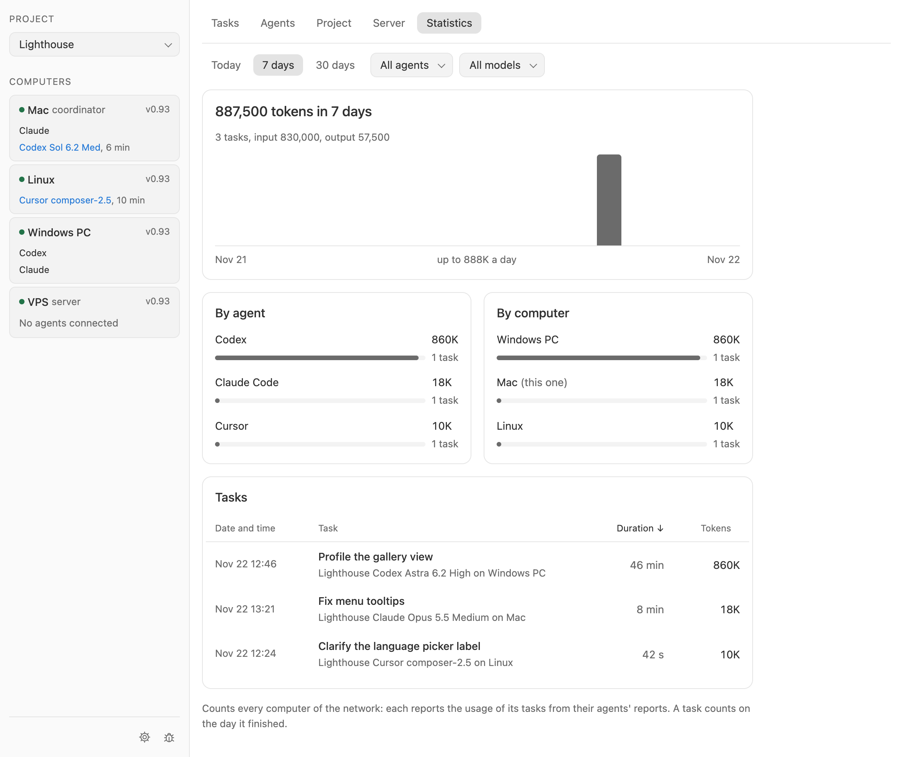
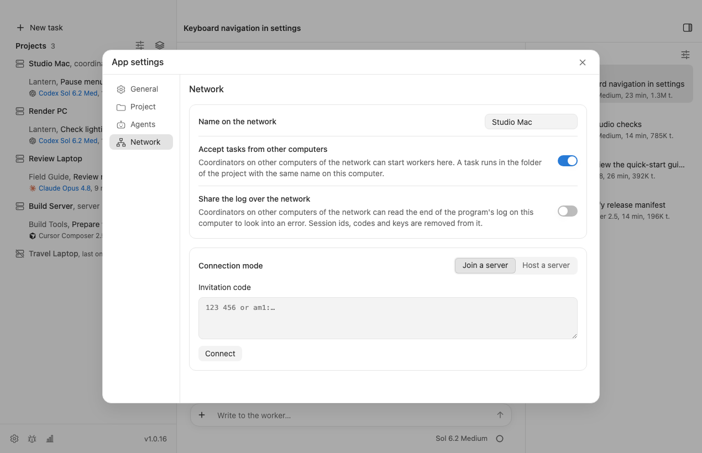

<h1 align="center">Kotel</h1>

One coordinator agent hands tasks to worker agents (Claude Code, Codex, Cursor Agent CLI) on your own computers: Mac, Windows and Linux, joined into one network. You watch every task in one window, answer the workers' questions and step in when needed.

**Technical preview.** Kotel runs on Apple Silicon Macs with macOS 15 or later, and on x64 and ARM64 Windows and Linux computers. Kotel verifies signed in-app updates. The Mac app is ad-hoc signed and the Windows executables are unsigned, so a first download can trigger an operating system prompt. See the [installation guide](docs/DOWNLOAD.md) for each platform.

<h3 align="center">Download</h3>

  &nbsp;
  &nbsp;
  

  ARM: <a href="https://github.com/kolotiloff/agent-messenger/releases/latest/download/Kotel-Windows-ARM64.exe">Windows</a> · <a href="https://github.com/kolotiloff/agent-messenger/releases/latest/download/Kotel-Linux-ARM64">Linux</a> · <a href="docs/DOWNLOAD.md">Installation and first steps</a> · <a href="https://github.com/kolotiloff/agent-messenger/releases/latest">Latest release</a>

<picture>
  <source media="(prefers-color-scheme: dark)" srcset="docs/assets/window-dark.png">
  
</picture>

The Kotel window with English controls and sample projects, computers and conversations. The Archive is open on the right. Change the theme or language in Settings at the bottom left.

## What it does

- **Coordinator and workers.** Use a local Claude Code, Codex or Cursor chat as the coordinator. It assigns work to separate worker sessions in the project folder. Claude Code can receive background-task notifications. Codex and Cursor use `wait` during an active turn to receive worker events.
- **Several computers.** Host the server on one of your computers or a Linux VPS. Join on the same local network with six digits, or use a long invitation with the server's reachable address. The coordinator can assign tasks to a computer that accepts them and has a folder for the project. Drag computer cards to set the order in your window.
- **Projects and tasks.** Switch between projects with separate task histories and statistics. See planned, active, finished and interrupted work, including the worker's reported model when available. Group active tasks by computer or project, or display them as a flat list.
- **Conversations and run controls.** Write to a worker or answer a question from the task view. Stop eligible tasks from the conversation or the task list and see the request status while Kotel waits for the result. Workers can attach images to reports and questions. Kotel preserves uncertain outcomes for review. **Any commands** is off by default.
- **Statistics and feedback.** Filter by period, project, agent, model or computer. Sort the task table by finish time, duration or tokens by clicking the column headings. The feedback button saves a note and an optional screenshot on this computer.
- **Updates from the window.** Use the update arrow next to the local version in the sidebar footer. In **Settings → Network → My network**, check versions and request updates on Windows and Linux computers. A queued request can be cancelled before installation starts.

  
Statistics screenshot

  

  
Network settings screenshot

  

## Getting started

1. [Download and start](docs/DOWNLOAD.md) the app on each computer.
2. Create a project from the welcome screen. On each worker computer, use the same project name and choose its local folder.
3. Open **Agents**. Install or find the CLI, sign in and confirm folder trust when prompted.
4. In **Project → MCP plugin**, connect Kotel for your coordinator. Open a new chat in that project folder and ask it to run `list_agents`.
5. For a network of computers, open **Settings → Network → Host a server** on the host and [invite each worker computer](docs/DOWNLOAD.md#connect-more-computers).

## Status

| Part | State |
|---|---|
| Mac app | Apple Silicon, macOS 15 or later. Updates through Sparkle. The preview is ad-hoc signed and awaits Apple notarization. |
| Windows and Linux | x64 and ARM64 packages. Windows installs for the current user. Linux can run from the downloaded file or install for the current user. Windows previews may trigger SmartScreen. |
| Workers | Claude Code, Codex and Cursor. Tests use fake CLIs only; real agents are checked in separate acceptance runs. |
| Network | Local network and internet modes, invitations by code and TLS with a pinned certificate. Use invitations for your own trusted computers. [Server guide](docs/BROKER.md) |
| In development | Full conversations for tasks assigned by another computer, coordinator handover between computers and a phone view. |

The current state and next tasks are in [HANDOFF.md](docs/HANDOFF.md) and [TASKS.md](docs/TASKS.md); the full map of documents is in [docs/README.md](docs/README.md).

## Documentation

- [Download and start](docs/DOWNLOAD.md), [Mac app](docs/MAC_APP.md), [Windows and Linux](docs/WINDOWS_LINUX.md), [updates](docs/UPDATES.md)
- [Task model: projects, tasks, workers](docs/TASK_MODEL.md)
- [Server and network of computers](docs/BROKER.md), [where to run it](docs/DEPLOYMENT.md)
- [Release plan](docs/RELEASE_PLAN.md), [decisions](docs/DECISIONS.md)
- [Building from source and the checks](docs/CLIENT.md), [CI](docs/CI.md)

## Project rules

The product is written in Go (`cmd/messenger`, `internal`), with a native Mac shell in `desktop/macos`. The packaged app runs without a Python or Node installation. Agent CLIs have their own prerequisites. The [CI guide](docs/CI.md) lists the tools used for builds and checks.

This repository is public. Keys, local profiles, queues, session IDs and their history are never uploaded here. Rules for coding agents working on the code are in [AGENTS.md](AGENTS.md).
