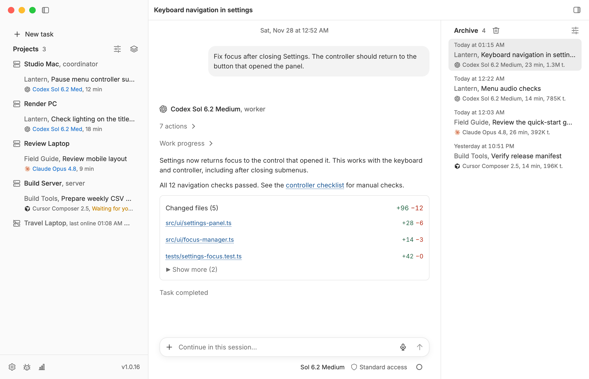

<h1 align="center">Agent Messenger</h1>

One coordinator agent hands tasks to worker agents (Claude Code, Codex, Cursor Agent CLI) on your own computers: Mac, Windows and Linux, joined into one network. You watch every task in one window, answer the workers' questions and step in when needed.

**Technical preview.** The app runs on macOS (Apple Silicon), Windows and Linux. Updates are signed and verified by Messenger. A fresh download may trigger Gatekeeper on Mac or SmartScreen on Windows. See the [installation guide](docs/DOWNLOAD.md) for each platform.

<h3 align="center">Download</h3>

  &nbsp;
  &nbsp;
  

  ARM: <a href="https://github.com/kolotiloff/agent-messenger/releases/latest/download/AgentMessenger-Windows-ARM64.exe">Windows</a> · <a href="https://github.com/kolotiloff/agent-messenger/releases/latest/download/AgentMessenger-Linux-ARM64">Linux</a> · <a href="docs/DOWNLOAD.md">Installation and first steps</a> · <a href="https://github.com/kolotiloff/agent-messenger/releases/latest">Latest release</a>

<picture>
  <source media="(prefers-color-scheme: dark)" srcset="docs/assets/window-dark.png">
  
</picture>

The task window with fictional data. Use the gear at the bottom left to change the theme or switch from Russian to English.

## What it does

- **Coordinator and workers.** Use a local Claude Code, Codex or Cursor chat as the coordinator. It assigns work to separate worker sessions in the project folder. Claude Code can receive background-task notifications. Codex and Cursor use `wait` during an active turn to receive worker events.
- **Several computers.** Host the server on one of your computers or a Linux VPS. Join on the same local network with six digits, or use a long invitation with the server's reachable address. The coordinator can see available agents and assign to a computer that accepts tasks and has a folder for the project.
- **Tasks and replies.** See task progress, the model, elapsed time and token usage. Open full conversations for tasks tracked by this computer, reply or stop work, and browse read-only summaries of other computers' tasks. Workers can attach images to reports and questions.
- **Run controls.** Interrupted or uncertain tasks appear under «Требуют решения» and are never restarted automatically. The «Любые команды» option is off by default.
- **Statistics and feedback.** Filter token usage by period, agent, model or computer. Browse the latest tasks or sort them by token use. The feedback button saves a note and an optional screenshot.
- **Updates from the window.** The update arrow appears next to the version on the computer card. Windows and Linux can also be updated from another computer on the network.

## Getting started

1. [Download and start](docs/DOWNLOAD.md) the app on each computer.
2. Create a project from the welcome screen. On each worker computer, use the same project name and choose its local folder.
3. Open **Агенты** (Agents). Install or find the CLI, sign in and confirm folder trust when prompted.
4. In **Проект → MCP-плагин** (Project → MCP plug-in), check the connection for your chosen local coordinator. Open a new chat in that project folder and ask which agents it sees.
5. To join more computers, open **Сервер** (Server), start the server and [invite each computer](docs/DOWNLOAD.md#connect-more-computers).

## Status

| Part | State |
|---|---|
| Mac app | Apple Silicon, macOS 15 or later. Updates through Sparkle. The preview is ad-hoc signed and awaits Apple notarization. |
| Windows and Linux | x64 and ARM64 packages. Windows installs for the current user. Linux can run from the downloaded file or install for the current user. Windows previews may trigger SmartScreen. |
| Workers | Claude Code, Codex and Cursor. Tests use fake CLIs only; real agents are checked in separate acceptance runs. |
| Network | Local network and internet modes, invitations by code and TLS with a pinned certificate. Use invitations for your own trusted computers. [Server guide](docs/BROKER.md) |
| Planned | Full remote task conversations, coordinator handover and a phone view. |

The current state and next tasks are in [HANDOFF.md](docs/HANDOFF.md) and [TASKS.md](docs/TASKS.md); the full map of documents is in [docs/README.md](docs/README.md).

## Documentation

- [Download and start](docs/DOWNLOAD.md), [Mac app](docs/MAC_APP.md), [Windows and Linux](docs/WINDOWS_LINUX.md), [updates](docs/UPDATES.md)
- [Task model: projects, tasks, workers](docs/TASK_MODEL.md)
- [Server and network of computers](docs/BROKER.md), [where to run it](docs/DEPLOYMENT.md)
- [Release plan](docs/RELEASE_PLAN.md), [decisions](docs/DECISIONS.md)
- [Building from source and the checks](docs/CLIENT.md), [CI](docs/CI.md)

## Project rules

The product is written in Go (`cmd/messenger`, `internal`), with a native Mac shell in `desktop/macos`. Building and running it needs no Python or Node.

This repository is public. Keys, local profiles, queues, session IDs and their history are never uploaded here. Rules for coding agents working on the code are in [AGENTS.md](AGENTS.md).
