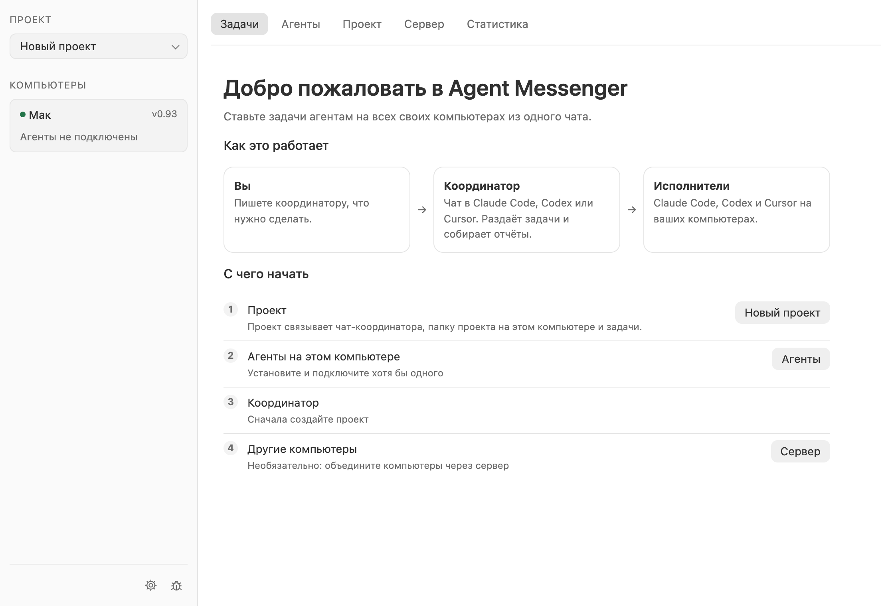

# Download and start

Download Kotel from [GitHub Releases](https://github.com/kolotiloff/agent-messenger/releases/latest). The buttons in the [README](../README.md) always point to the current packages. A GitHub account is not required. Existing users can update from the version arrow on their computer. The Kotel bridge opens the same projects, settings and history. Choose the file for your operating system and processor for a fresh installation.

| File | For |
|---|---|
| `Kotel-Mac.zip` | Mac with Apple Silicon, macOS 15+ |
| `Kotel-Windows-x64.exe` | Windows 10/11 on Intel or AMD |
| `Kotel-Windows-ARM64.exe` | Windows 11 on ARM |
| `Kotel-Linux-x64` | Linux on Intel or AMD |
| `Kotel-Linux-ARM64` | Linux on ARM |
| `Kotel-Windows-Linux-SHA256.txt` | SHA-256 of the four Windows and Linux files |
| `install-server.sh` | Optional Linux server installer for a VPS |
| `update-<os>-<arch>.json`, `.sig`, `<sha256>.zip` | Signed update files used by the app |

On Mac, check **About This Mac** for an Apple chip. Intel Macs do not have a build. On Windows, check **Settings → System → About → System type** for x64 or ARM64. On Linux, `uname -m` reports `x86_64` for x64 and `aarch64` for ARM64.

## Mac

1. Download `Kotel-Mac.zip` and unzip it. If your browser already unpacked it, look for `Kotel.app` in Downloads.
2. Move the app to your Applications folder, for example `~/Applications`, and open it from there.
3. If macOS says it cannot verify the developer or check the app for malicious software, dismiss the message. Open **System Settings → Privacy & Security**, scroll down to **Security**, and look for the message about Kotel and **Open Anyway** («Открыть всё равно»). It appears after you have tried opening the app. Click it for the official download and confirm in the next dialog. If it is absent, try opening the app once from its final location and return to that panel. [Apple's first-open instructions](https://support.apple.com/en-us/102445)

The technical preview is ad-hoc signed and is not notarized by Apple. Data lives in `~/Library/Application Support/AgentMessenger`. Use the update arrow next to this computer's version at the bottom left, or choose **Kotel → Проверить обновления…** (Check for updates) in the Mac menu. [Mac app](MAC_APP.md)

## Windows

1. Download `Kotel-Windows-x64.exe` (or `-ARM64.exe` on ARM).
2. Double-click it. A SmartScreen prompt for the official download may offer **More info** and then **Run anyway**. Windows 11 Smart App Control can block an unsigned program without offering that option. [Windows app protection](https://support.microsoft.com/en-us/windows/security/windows-security/app-browser-control-in-the-windows-security-app)
3. On the first start the program installs itself for the current user, without administrator rights (D-082): it copies itself to `%LOCALAPPDATA%\Programs\Agent Messenger`, adds «Kotel» to the Start menu and to Settings → «Приложения». Then the installed copy opens. The downloaded file is no longer needed. Starting an older download opens the installed newer version instead.
4. Kotel uses WebView2 for its window and opens in the browser if WebView2 is unavailable. Closing the desktop window hides it in the notification area while the background client and its tasks keep running. Reopen it from the notification area or Start menu.
5. To remove it: Settings → «Приложения» → Kotel → «Удалить». Removal is refused while tasks run. It stops the background client and removes the program, the shortcut and the entry. The data stays.

Data lives in `%LOCALAPPDATA%\AgentMessenger` and stays when you uninstall the app. Use the arrow next to this computer's version to update. [Updates](UPDATES.md#windows-and-linux)

## Linux

In the download folder, mark the file executable and open the app:

```bash
chmod +x Kotel-Linux-x64
./Kotel-Linux-x64 open
```

For ARM use `Kotel-Linux-ARM64` in both commands. The optional `./Kotel-Linux-x64 install` command installs `messenger` and the `kotel` alias in `~/.local/bin`. The app opens a desktop window with WebKitGTK 4.1 or 4.0. Without it, Kotel tries a browser window.

Data lives in `$XDG_DATA_HOME/agent-messenger` or `~/.local/share/agent-messenger`. Use the arrow next to this computer's version for updates. When running the downloaded file directly, keep it in a directory you can write to. To stop the background client, run the same binary with `shutdown` in place of `open`. [Linux details](WINDOWS_LINUX.md)

## Server on a Linux VPS

One command as root installs the network server as a service and prints an invitation; running it again updates it ([details](BROKER.md)):

```bash
curl -fsSL https://github.com/kolotiloff/agent-messenger/releases/latest/download/install-server.sh | sh
```

`agent-messenger-server invite` gives a new invitation, `agent-messenger-server status` shows the state and the connected computers.

## First steps



1. On the welcome screen, choose **New project**, enter a name and select its folder. On other computers use exactly the same project name and select the local folder there.
2. Under **Agents**, choose **Install** to launch the provider's installer, or **Find** if the CLI is already installed. Wait for the terminal to finish. If it was closed and Kotel could not confirm installation, use **Find** to check for the CLI. Workers use the CLI and can run without the agent's graphical app.
3. Use **Sign in** on the agent card and complete the provider's sign-in. If Codex asks to trust the project folder, choose **Trust folder** on its card and confirm the exact folder in the terminal.
4. Under **Project → MCP plugin**, check the connection for Claude Code, Codex or Cursor. Use **Connect** if needed. Open a **new local chat** in that folder, ask it to run `list_agents`, and approve Kotel's tools when prompted.

For Cursor, enable the project's `kotel` connection in its MCP settings if the new chat cannot see the tools. Keep any existing legacy entries while using chats with saved permissions. If the tools are missing, reopen the project chat after enabling the source. The coordinator needs access to local project tools. Claude Code can use background notifications while waiting. Codex and Cursor receive updates by keeping a turn active and calling `wait`.

## Connect more computers

1. On the host, open **Settings → Network → Host a server**, choose **Local network** and press **Start server**.
2. Click **Invite a device**. On the other computer, open **Settings → Network → Join a server**, paste the six-digit code and click **Connect**. Use a fresh invitation for each computer.
3. If two computers cannot find each other by six digits, try the long `am1:…` invitation with a server address the other computer can reach. Six-digit discovery needs UDP 47100 on the local network, and the connection itself uses the chosen TCP port (47100 by default). Check Windows Firewall on the server computer and make sure the systems are on the intended network. Guest Wi-Fi isolation can block discovery.
4. On each worker computer, set its project folder and check **Accept tasks from other computers**.

The **My network** section shows each computer’s status and version. You can request updates for Windows and Linux computers from this list.

For computers in different networks, use a reachable address in **Интернет** (Internet) mode and the long invitation, or a shared VPN. A home router or a VPS firewall may need an inbound TCP rule for the server port. [Network and invitation details](BROKER.md#computers-in-different-places)

## Check a download (optional)

```bash
sha256sum -c Kotel-Windows-Linux-SHA256.txt --ignore-missing
```

On Windows, run `Get-FileHash .\Kotel-Windows-x64.exe -Algorithm SHA256` in PowerShell and compare it to the matching line in the checksum file. Use the ARM64 file name for that download.
