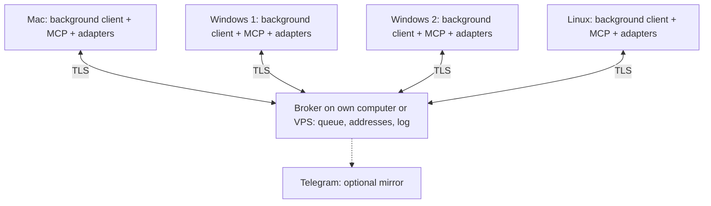

**Agent Messenger — working plan v0.3: the app and a portable broker**

> **Historical.** The original architecture of November 5, 2026. For the current state see [RELEASE_PLAN.md](RELEASE_PLAN.md#current-status).

Updated November 5, 2026. The user approved continuing in stages and including the UI/installation in the MVP. Local CLI experiments and experimental code are done; there is no finished app yet. Actual readiness and limitations are in [VALIDATION.md](VALIDATION.md).

**1. Purpose and working order**

Agent Messenger delivers messages between agents on four computers: `mac`, `win-1`, `win-2`, `linux`. The initial participants are Claude Code, Cursor Agent CLI and Codex. Connecting another agent should require a new adapter while keeping the message protocol.

Claude on the Mac remains the coordinator for now: it distributes tasks, maintains the project's roadmap and documentation, and agrees on file owners. Messenger stores the correspondence, addresses and technical delivery/processing statuses. For Messenger, task data is the content of a message, not its own development management system.

Agent Messenger is developed in a separate GitHub repository and does not depend on the project's tools. Client queues, passwords and CLI session stores live outside the project's synced folder. Document paths may be passed relative to the project; Messenger itself does not modify files and does not manage version control.

Order: CLI under client control → a safe local core and recovery → a status/conversation window on the Mac → an installable release → a broker on the user's own computer or a VPS, and Mac↔Windows → four computers and coordinator handover → optional Telegram. [Stages and criteria](MVP.md). Codex already takes part in local experiments.

**2. Architecture**

The UI is part of the first user-facing MVP: agent and computer cards, installation/authorization, queue management and a conversation window. It talks to the single local client and does not launch CLIs independently. [Detailed requirements](APP.md).

Product stack: Go for the local client and the future broker, SQLite for durable storage. The Python test bench remains the source of verified scenarios, not an intermediate version of the client; there is no planned rewrite of a finished client from Python to Go. The driver choice, stage boundaries and client commands are in [CLIENT.md](CLIENT.md). Packaging is still to be chosen at release time, after the platforms are verified.

The same broker component runs on a VPS or on one of the user's computers; for local mode, on the same Mac. The client connects by address and by the server's authenticated identity. The app offers «Подключиться к серверу» ("Connect to server") and «Запустить сервер на этом компьютере» ("Run server on this computer"). The server package runs without a GUI; the computer hosting the broker can run agent tasks at the same time. [Modes, settings and migration](DEPLOYMENT.md).

On the chosen node: one broker instance, an HTTPS API and WebSocket over TLS, the database on persistent disk. The broker stores messages, per-recipient deliveries, role versions, permissions and an event log. It acknowledges receipt only after the record is committed. Four machines need no separate Redis, Kafka or cluster. Backups and restore testing are mandatory; a single broker node remains a single point of temporary unavailability regardless of where it is hosted.

Each client establishes its own outbound connection to the chosen broker. Client computers need no inbound ports; the computer hosting the broker must be reachable over the chosen route — the local network, a VPN, or explicitly configured internet access. Enabling the server role does not by itself configure NAT. A local broker listens only on the local address by default; network access is enabled separately. WebSocket speeds up notification; the queue remains the source of truth. After a disconnect, the client rereads unacknowledged deliveries by cursor. The fallback transport is HTTPS long polling in ordinary code.

The local client contains inbound and outbound queues on disk, a session registry, sequential launching of handlers, a results log and CLI adapters. It runs as the user who has the agents configured: a LaunchAgent on the Mac, a task at user login on Windows, a systemd user service on Linux. Running before user login will be checked separately if it is ever needed.

The MCP wrapper works over stdio and talks to the already running client over local IPC with access checks. It must not be the parent of the single long-lived client: CLI exit can terminate its MCP process. The background client's lifecycle belongs to the OS. MCP support is described for [Claude](https://code.claude.com/docs/en/mcp), [Codex](https://learn.chatgpt.com/docs/extend/mcp?surface=cli) and [Cursor CLI](https://cursor.com/docs/cli/using).

**3. Waiting without spending tokens**

With an empty queue, an ordinary client is running. In the current persistent Claude mode, the managed CLI stays running and receives no new user messages until work appears. Exiting the CLI between messages and safely releasing the owner within the same OS boot are not implemented yet. The server connection, heartbeat, reconnection, lock checks and acknowledgements are performed by the program without calling the model. A timer on which the agent itself asks "are there any messages?" is not used.

A new substantive message triggers one processing run when the session is free. One run may include several model and tool calls: there is no promise of "one message — one API request". Autonomous loops and background jobs built into the CLI must be identified and disabled for the waiting test profile.

Technical ACKs, online presence and ordinary statuses do not launch an agent. A reply to a task launches the coordinator only according to local policy. A conversation has a limit on automatic replies, a processing time limit and a stop on repeated errors, so that agents do not exchange endless acknowledgements. Repeated deliveries of the same ID do not create new model calls.

"Zero tokens while waiting" refers to this waiting mechanism. Processing a new message, restored context, history compaction and the user's own actions are accounted for separately. VPS hosting, if chosen, and network traffic are accounted for separately.

**4. Addresses and the message**

We separate the participant address from the internal conversation ID:

| Entity | Example | Purpose |
|---|---|---|
| Project | `project-main` | Boundary for addresses and permissions |
| Machine | `win-1` | Delivery device |
| Participant | `project-main/win-1/cursor-worker` | Stable mailing address |
| Role | `role:coordinator` | Reassignable coordinator address |
| Session binding | `binding-17` | Local link to a specific CLI and its conversation |

The sender does not pass the CLI identifier as a launch command. The local binding contains the provider, the exact `session_id`, the account profile, the storage directory, the working folder, the CLI path and version, the allowed tools and the ownership mode: `managed` or `interactive`.

The envelope contains: `protocol_version`, `message_id`, `client_request_id`, `project_id`, the authenticated `from`, the requested `to`, the actual recipient, `conversation_id`, `in_reply_to`, the type (`message`, `request`, `result`, `status`), the text, the time the broker received it, an optional expiry and links to documents. `task_id`, if needed, remains an external label. For the coordinator, the role assignment version is recorded.

`message_id` identifies the message; `client_request_id` allows safely retrying a send after a lost response. Deduplication takes the project and the sender into account. A repeated key with different content returns an error. Keys are retained for at least the allowed redelivery period. A single broadcast request is expanded into separate deliveries; the MVP has no broadcast.

The receipt time and queue number are assigned by the broker: ordering does not depend on Windows or Mac clocks. FIFO applies per recipient/binding, with no global order across all machines. Changing a binding must not mix two queues of the same CLI session.

**5. Queues, acknowledgements and failures**

Delivery and execution have different statuses:

| Status | What it actually means |
|---|---|
| `local_pending` | The sender saved the message locally; the broker has not acknowledged it yet |
| `accepted` | The broker durably stored the message |
| `delivered` | The recipient durably stored it in its inbound queue |
| `queued` | The message is waiting for a free session |
| `started` | The adapter confirmed that processing started in the correct session |
| `completed` | The CLI finished processing; the result is durably recorded |
| `needs_attention` / `uncertain` | A permission, account login or analysis of an ambiguous failure is needed |

`delivered` does not mean the model read the message. `completed` means processing of the message finished, not proven readiness of a development task. A "need clarification" reply can also be a correct processing result.

The sender first writes to the outbox, then sends. The recipient first writes to the inbox, then acknowledges delivery. The broker retries unacknowledged deliveries with increasing delay. A repeated ID is acknowledged without a new run. Processing completion and the outgoing final reply are committed in one local transaction; sending the reply is then retried independently of the model.

The final reply has a stable key linked to the original message. MCP `reply` and the adapter's automatic publication of the final answer follow one policy: if the final result has already been recorded via MCP, a second one is not created. Intermediate messages are allowed separately.

The transport guarantee is at-least-once delivery with deduplication. "Exactly-once execution of any agent action" is not promised. On a crash between an agent action and the recording of its result, it is impossible to always tell what was done. Such a run gets `uncertain`; reading logs and a decision by a human/the coordinator precede any rerun.

New jobs do not start without a valid broker permission. On a connection loss, a run already started may finish and save its result locally; the following ones wait for recovery. Expiry of a network lease does not grant the right to start a copy on another machine. Authorization errors stop attempts; expired messages and exhausted attempts are visible in the attention queue rather than disappearing.

**6. A single owner of a saved session**

The main rule: a specific conversation can have only one active execution owner. The restriction applies to the real key `(machine, provider, store/profile, session_id)`, not only to the mailing address. Two different addresses must not bypass this check.

The local client uses an OS lock, a launch log and a controlled CLI process. A second client must also acquire the same lock. After a restart, not only the PID is checked but also the process identity/start time and its child processes. A released lock or an old PID by themselves do not prove that the previous CLI has stopped. If the state is unknown, the queue stops.

The broker additionally issues an owner generation number to reject stale connections and statuses. This protection cannot undo an action of an already running model or lock a project file: what matters for execution is the local lock and a confirmed process stop.

An arbitrary CLI launched directly by the user may not respect the Messenger lock. Therefore, to provide the guarantee, a managed session is launched only through the client. Switching to manual work: pause the queue → wait for completion and verify the process is gone → hand ownership to the human → return it to the client after they exit. For an open coordinator in interactive mode, incoming messages are stored and shown as a notification; a parallel `resume` is not performed.

For a fully automatic coordinator reply, its test session must be handed over to the managed client. Supported injection of a message into a live session through a provider-specific API is a separate adapter after verification, not a universal property of MCP.

Before each run, the binding, profile, working folder, permissions, existence of the known session and whether it is busy are checked. Only the exact saved ID is used, without `--last`, `--continue` or lookup by an ambiguous name. The adapter checks the ID in the structured launch event; an unexpected ID or inability to verify the binding blocks automatic processing. A resume error must not silently create a new conversation.

The text is passed as data via stdin where supported, or via an argument array without a shell. The sender does not specify the executable, working folder, profile, access flags or a shell command. Completion is determined by structured events and the result, not only by the exit code.

**7. Differences between Claude, Codex and Cursor**

The commands below are reference points for the adapters. Basic sequential resumes of the three CLIs have already been verified on the Mac; the actual settings and limitations are recorded in the reports. Argument order, input, JSON events and permissions must be confirmed on the installed version on each machine.

| Agent | Basic path for a finished saved session | What is important to check |
|---|---|---|
| Claude Code | `claude -p --resume <ID> --output-format json <message>` | Save `session_id` on the first run; do not enable the no-persistence mode. `--fork-session` creates a different conversation. |
| Codex | `codex exec resume --skip-git-repo-check --json <ID> <message>` | Save `thread_id` from JSONL; do not use `--ephemeral`. Working outside Git requires the corresponding flag. |
| Cursor Agent CLI | `agent -p --resume=<ID> --output-format json <message>` | There is `agent create-chat` to obtain an ID; check the print/resume combination, history persistence and the ID in the result. |

Sources: [Claude headless](https://code.claude.com/docs/en/headless), [Claude CLI reference](https://code.claude.com/docs/en/cli-reference), [Codex non-interactive](https://learn.chatgpt.com/docs/non-interactive-mode), [Cursor parameters](https://cursor.com/docs/cli/reference/parameters).

For Claude, handling an already running background session differs from loading a finished history: the documentation describes attach and refusal for some combinations of input/output redirection and parameters. Therefore the `-p --resume` combination cannot unconditionally be considered a launch of a new independent headless run. The basic adapter accepts only a finished session that it owns. [Claude sessions](https://code.claude.com/docs/en/sessions).

Codex has a separate App Server: `thread/resume` loads a conversation, `turn/start` starts processing; `turn/steer` applies to an active turn. This is a possible next adapter for a live session. Continuing requires `thread.id`, not an arbitrarily chosen session-tree identifier. [Codex App Server](https://learn.chatgpt.com/docs/app-server).

The current Codex documentation also describes `codex queue`, including a `--resume` option. On this Mac, the help of the installed `codex-cli 0.155.1` confirms `queue`, `exec resume`, `--json` and `--skip-git-repo-check`, but the `queue` help has no `--resume` option. This version mismatch needs checking; the MVP does not depend on `queue`. The documentation separately warns that a failed wake-up via queue can produce a warning with a successful exit. [Codex developer commands](https://learn.chatgpt.com/docs/developer-commands).

The Cursor IDE/GUI and the CLI have different conversation stores: a Cursor employee reconfirmed this on October 20, 2026. Resuming the CLI by ID cannot be considered a continuation of an open GUI chat. [Cursor's answer](https://forum.cursor.com/t/local-ide-agent-chats-and-the-agent-cli-still-use-separate-session-stores/165486/10).

The Cursor changelog describes waking on output of an observed background command in ACP mode. This confirms a specific ACP scenario, not universal delivery into an idle GUI. The claim from earlier correspondence about `notify_on_output` for the GUI remains an unverified hypothesis; the MVP does not use it. [Cursor changelog](https://cursor.com/docs/cli/changelog).

Cursor currently documents both native installation on Windows and WSL. We check the native variant on `win-1` first; WSL is a fallback after verifying paths, the user profile and access to the working directory. [Cursor installation](https://cursor.com/docs/cli/installation).

Each CLI stores history in its own way. Resume does not carry memory between Claude, Codex and Cursor and does not guarantee restoring OS processes or the state of external applications. Changing provider/machine is a new binding with an explicit context handoff, not a substitution of the history format.

**8. MCP tools and authorization**

| Tool | Purpose |
|---|---|
| `messenger.send(to, text, client_request_id, conversation_id?)` | Save and send a message; return the ID and the real acceptance status |
| `messenger.inbox(cursor?, limit?)` | Read a bounded page of available messages |
| `messenger.read_current()` | Read the one message assigned to the current execution |
| `messenger.reply(text)` | Reply to the assigned message; the recipient, link and retry key are set by the client |
| `messenger.status(message_id)` | Get the technical status without launching the recipient |
| `messenger.peers()` | Get the allowed recipients and their availability |

In the mode for processing an incoming message, only `read_current` and `reply(text)` are available: a generic `send` must not allow passing off an unrelated reply as the job's result. The coordinator's own assignments use a separate permitted mode. This refinement is based on a local experiment in which the model chose to send a new message instead of replying. The actual tool names in the Python test bench do not yet have the `messenger` prefix.

`from` is determined by the authenticated MCP binding, not by the argument text. Reading the inbox does not delete a message and does not acknowledge successful processing. Transport ACKs, queue claiming, locks and process completion are handled by the client, not the model. MCP here gives the agent communication tools; waking is provided by the adapter.

At registration, each machine is issued a separate revocable broker access secret, restricted to its addresses and projects. The broker stores verifier values of the secrets; the connection is always over TLS. The local MCP gets limited access to its binding via IPC with the current user's permissions, without being given the broker's administrative secret. Device certificates may be added later for stronger protection; for the MVP, separate tokens, revocation and a log are sufficient.

The broker checks the right to send to a specific recipient, read its queue and publish results. A revoked key stops delivery and reconnections. A remote message cannot change the account, the executable, CLI permissions, or assign itself the coordinator role. A shared secret for all four computers is not used.

Claude/Cursor/Codex accounts are authorized locally. Their keys and login sessions are not sent to the broker and are not placed in the project repository. Two accounts of the same provider are set up as different local profiles with explicit bindings. When a login expires — `needs_attention`, without automatic account substitution or a hidden switch to another billing scheme.

CLI tool permissions are set separately from the right to receive messages. The test profile gets only messaging tools and the necessary read access to test data. If a CLI requires interactive permission, the client records the need for a user action; flags that fully bypass confirmations are not substituted automatically. Headless permission conditions are checked for the specific version.

The content of a message is input data with a known sender, not a system instruction. The server limits message size and request rate; logs contain no login secrets. In this design the broker sees the text of the correspondence: end-to-end encryption between machines is not part of the MVP. Agents under the same OS account may share file access; MCP permissions by themselves do not isolate such processes.

**9. Coordinator handover**

`role:coordinator` is a `{agent_address, generation}` record in the broker. Initially it points to Claude on the Mac. It can be reassigned to Codex, Cursor or another registered agent regardless of the model vendor.

Planned handover:

1. Pause the sending of new coordination jobs by the old owner. Record active assignments and unfinished conversations.
2. Prepare a handover message: links to the roadmap and documentation, current file agreements, active tasks, questions and links to the Messenger history.
3. The new coordinator confirms receipt of the context in its session. Wait for a safe moment to hand over ownership of the project documents.
4. An administrator or an explicitly authorized procedure atomically changes the role address, checking the previous generation. Agents do not reassign the role with one ordinary message.
5. Resume sending. The broker rejects new coordination messages from the old generation. Before starting a not-yet-started assignment, the recipient checks the generation; a stale assignment requires confirmation from the new coordinator.

The role address is resolved to a specific recipient when a message is accepted. Already accepted messages do not disappear or silently jump between recipients. Unread messages to the old coordinator are transferred by an explicit operation with a log and without re-executing tasks. Replies from current workers stay linked to the original assignments and are available to the new coordinator in the handover history.

At the start, a manual role switch by the system owner is sufficient. There is no automatic coordinator election when the Mac disappears: a network loss does not prove that the old agent has stopped working. In an emergency handover, already running workers and file access must be reconciled separately. Messenger does not provide distributed locks for project files: coordinating changes remains the responsibility of the workers and the coordinator.

**10. Technical hypotheses to verify**

The documentation and local experiments confirm individual mechanisms, but not system readiness on all platforms. On the Mac, basic resumes of the three CLIs, two exchange pairs and 19 tests without models have been verified, as well as the new mechanism with real Claude, Codex and Cursor. Current statuses are in [VALIDATION.md](VALIDATION.md); Windows/Linux and the network have not been verified yet. Experiments are run on separate test sessions, not on the coordinator's working conversation.

| ID | Hypothesis and how to test it | Success criterion / action on failure |
|---|---|---|
| H1 | Claude: the first headless run memorizes a random control phrase; a second process with the exact ID asks for it without it being repeated | Same ID and correct answer after a client restart; otherwise the automatic adapter is not allowed |
| H2 | Cursor: repeat H1 natively on Windows with print/resume, in a folder without Git | History and ID preserved, input/output correct; WSL is investigated separately on failure |
| H3 | Codex: repeat H1 with JSONL and `--skip-git-repo-check` | Same `thread_id`, works without `.git`; adapter test first, then connection to the MVP |
| H4 | All CLIs: nonexistent ID, wrong folder, different profile, corrupted/inaccessible history | No silent new conversation; the client detects the mismatch and stops |
| H5 | MCP: each CLI in headless mode sees only allowed tools, calls send/reply, survives the end of its MCP process | Delivery and the background client keep working; a permission refusal is visible to the user |
| H6 | No parallelism: two messages, two client instances and a manual attempt to open one managed session | At most one owner; the second message waits. Directly bypassing the client is an unsupported mode |
| H7 | Failure during a run: kill the client before/after the CLI starts, leave a child process, restart the client | No second executor; uncertainty becomes `uncertain`, not an automatic retry |
| H8 | Delivery: lose an ACK, disconnect the network, restart the broker, repeat the same ID, check a content conflict | The message is recovered; a duplicate does not launch the model; a key conflict is rejected |
| H9 | Waiting: after all runs finish, leave the system for 60 minutes; perform network reconnections | Zero CLI launches and zero new model calls caused by Messenger; counters are supplemented with available provider statistics |
| H10 | Profiles: two accounts of one provider, expired login, headless tool restrictions | Only the selected profile is launched; no account substitution and no endless retries |
| H11 | Platforms: autostart, sleep/wake, reboot, Cyrillic characters and spaces in paths | The queue is preserved; permissions and paths match the test binding; after a CLI update a short check is repeated |
| H12 | Coordinator: switch the role while a queue exists and an old client is disconnected | New messages go to the new address; the stale generation does not issue new assignments; old results are available |
| H13 | Security: foreign/revoked token, spoofed sender, foreign project, attempt to pass launch flags in the text | The request is rejected or remains plain text; the execution configuration does not change |
| H14 | Additional: Codex queue/App Server, live Claude background sessions, Cursor ACP and GUI | For each, separately confirm busy/idle, message order and ID preservation. These checks are not a condition of the basic CLI MVP |

For H9, the goal is to prove that the waiting mechanism makes no model calls. Changes in overall account usage due to other chats cannot be attributed to Messenger; the check is done under controlled activity.

**11. MVP: an app on the Mac, then Mac↔Windows**

The first user-facing version contains the local client, MCP/CLI adapters and a status/conversation window. It offers installation of missing CLIs, standard authorization, explicit binding of a test session and a visible attention queue. The app package and installation instructions for a human or an agent are published in GitHub Releases after the build is verified.

The next stage extends the same interface with a network broker on the user's own computer or a VPS and a client on Windows. Final support for two Windows machines and Linux is verified separately. A simple UI is mandatory; a large task editor, attachments and project management are not part of the MVP.

The single up-to-date table of stages and criteria is in [MVP.md](MVP.md); the detailed contents of the window and installation are in [APP.md](APP.md). There is no longer any need to duplicate the old A–F sequence here.

**12. Optional Telegram mirror**

Added after messaging works. One component next to the broker reads its events and publishes selected messages to a pre-approved chat: who wrote to whom, a brief result, errors and the need for intervention.

The mirror has its own queue and its own retries; a Telegram failure does not affect delivery to agents and does not launch a model. By default the mirror is read-only for a human. If writing to agents from Telegram is needed later, it is a separate input: allowed user/chat IDs, an explicit recipient, an authority check and an ordinary message into the broker. Access to secrets and direct shell execution via Telegram are not provided. Full logs and the contents of sensitive files are not mirrored automatically.

**13. Agreed scope and next decisions**

We continue local development and testing on the Mac. The architecture includes a portable broker (own computer or VPS), the local client, MCP, sequential CLI adapters, the interface and installable builds. The repository stays private per the user's latest instruction.

The new bound MCP and reservations passed the basic scenario with three CLIs on the Mac. The next step is a persistent local Go client on one Mac: recovery, a single registry and local commands for the future window. The network broker, GUI, installer and autostart are not part of this step. There is no need to wait for all network research to finish in order to start the UI later, once the states are defined.

The specific UI framework is chosen by a technical check of packaging and local IPC. The broker node, the network access method, device registration data and the Windows environment are refined for the network stage; renting a VPS is optional. Buying a server, changing subscriptions, publishing the repository and taking over the working coordinator are not implied automatically.

## Computer names and network addresses

When a device is connected, its default display name is taken from the computer's system name. The user will be able to set their own name; the local device is marked «Этот компьютер» ("This computer"). A long name is truncated in the list; the full name is available in the tooltip and properties. The device list scrolls independently of the settings below it.

Routing uses a persistent device identifier, not the display name or IP. Renaming and duplicate names do not change the recipient. The connection goes through the chosen broker on a computer or a VPS. This is a requirement of the network stage, not a feature that already works in the current local preview.
