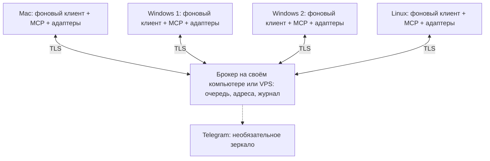

**Agent Messenger — рабочий план v0.3: приложение и переносимый брокер**

Обновлено 5 ноября 2026 года. Пользователь согласовал поэтапное продолжение и включение интерфейса/установки в MVP. Выполнены локальные опыты CLI и экспериментальный код; готового приложения пока нет. Фактическая готовность и ограничения — в [VALIDATION.md](VALIDATION.md).

**1. Назначение и порядок работы**

Agent Messenger доставляет сообщения между агентами на четырёх компьютерах: `mac`, `win-1`, `win-2`, `linux`. Начальные участники — Claude Code, Cursor Agent CLI и Codex. Подключение следующего агента должно требовать нового адаптера, сохраняя протокол сообщений.

Claude на Mac пока остаётся координатором: распределяет задачи, ведёт roadmap и документацию проекта, согласует владельцев файлов. Messenger хранит переписку, адреса и технические статусы доставки/обработки. Данные о задаче для него — содержимое письма, а не собственная система управления разработкой.

Agent Messenger разрабатывается в отдельном GitHub-репозитории и не зависит от инструментов проекта. Клиентские очереди, пароли и хранилища CLI-сессий размещаются вне синхронизируемой папки проекта. Пути к документам можно передавать относительно проекта; Messenger сам не изменяет файлы и не управляет системой контроля версий.

Порядок: CLI под контролем клиента → безопасное локальное ядро и восстановление → окно статусов/переписки на Mac → устанавливаемый выпуск → брокер на своём компьютере или VPS и Mac↔Windows → четыре компьютера и смена координатора → необязательный Telegram. [Этапы и критерии](MVP.md). Codex уже участвует в локальных опытах.

**2. Архитектура**

UI включён в первый пользовательский MVP: карточки агентов и компьютеров, установка/авторизация, управление очередью и окно переписки. Он обращается к единому локальному клиенту и не запускает CLI независимо. [Подробные требования](APP.md).

Стек продукта: Go для локального клиента и будущего брокера, SQLite для устойчивого хранения. Python-стенд остаётся источником проверенных сценариев, а не промежуточной версией клиента; планового переписывания готового клиента с Python на Go нет. Выбор драйвера, границы этапа и команды клиента — в [CLIENT.md](CLIENT.md). Упаковка по-прежнему выбирается при выпуске, после проверки платформ.

Один и тот же компонент брокера запускается на VPS либо на одном из компьютеров пользователя; для локального режима — на том же Mac. Клиент подключается по адресу и удостоверенной идентичности сервера. В приложении доступны «Подключиться к серверу» и «Запустить сервер на этом компьютере». Серверный пакет работает без GUI; компьютер с брокером может одновременно выполнять агентские задачи. [Режимы, настройки и перенос](DEPLOYMENT.md).

На выбранном узле — один экземпляр брокера, HTTPS API и WebSocket через TLS, база на постоянном диске. Брокер хранит сообщения, доставки по адресатам, версии ролей, разрешения и журнал событий. Подтверждает приём только после фиксации записи. Для четырёх машин отдельные Redis, Kafka и кластер не нужны. Резервное копирование и проверка восстановления обязательны; один узел брокера остаётся единой точкой временной недоступности независимо от места размещения.

Каждый клиент сам устанавливает исходящее соединение с выбранным брокером. Клиентским компьютерам входящие порты не нужны; компьютер с брокером должен быть доступен по выбранному маршруту — локальная сеть, VPN или явно настроенный доступ через интернет. Включение серверной роли само по себе не настраивает NAT. Локальный брокер по умолчанию слушает только локальный адрес; сетевой доступ включается отдельно. WebSocket ускоряет уведомление; источником истины остаётся очередь. После разрыва клиент перечитывает неподтверждённые доставки по курсору. Резервный транспорт — HTTPS long polling обычным кодом.

Локальный клиент содержит входящую и исходящую очереди на диске, реестр сессий, последовательный запуск обработчиков, журнал результатов и адаптеры CLI. Запуск — под пользователем, у которого настроены агенты: LaunchAgent на Mac, задача при входе пользователя на Windows, пользовательская служба systemd на Linux. Работу до входа пользователя проверяем отдельно, если она понадобится.

MCP-обёртка работает через stdio и обращается к уже запущенному клиенту по локальному IPC с проверкой доступа. Она не должна быть родителем единственного долгоживущего клиента: завершение CLI может завершить его MCP-процесс. Жизненный цикл фонового клиента принадлежит ОС. Поддержка MCP описана у [Claude](https://code.claude.com/docs/en/mcp), [Codex](https://learn.chatgpt.com/docs/extend/mcp?surface=cli) и [Cursor CLI](https://cursor.com/docs/cli/using).

**3. Ожидание без расхода токенов**

При пустой очереди работает обычный клиент. В текущем постоянном режиме Claude управляемый CLI остаётся запущенным и не получает новые пользовательские сообщения до появления работы. Завершение CLI между письмами и безопасное освобождение владельца в той же загрузке ОС пока не реализованы. Соединение с сервером, heartbeat, переподключение, проверка блокировок и подтверждения выполняются программой без обращения к модели. Таймер, на котором сам агент спрашивает «есть ли сообщения?», не используется.

Новое содержательное сообщение вызывает один запуск обработки, когда сессия свободна. Один запуск может включать несколько обращений к модели и инструментам: обещания «одно письмо — один API-запрос» нет. Включённые в CLI автономные циклы и фоновые задания нужно выявить и отключить для тестового профиля ожидания.

Технические ACK, присутствие в сети и обычные статусы не запускают агента. Ответ на задачу запускает координатора только согласно локальной политике. Для беседы задаются предел автоматических ответов, лимит времени обработки и остановка при повторяющихся ошибках, чтобы агенты не обменивались бесконечными подтверждениями. Повторные доставки одного ID не создают новые обращения к модели.

«Ноль токенов при ожидании» относится к этой механике ожидания. Обработка нового письма, восстановленный контекст, сжатие истории и самостоятельные действия пользователя учитываются отдельно. Размещение на VPS, если оно выбрано, и сетевой трафик учитываются отдельно.

**4. Адреса и сообщение**

Разделяем адрес участника и внутренний ID разговора:

| Сущность | Пример | Назначение |
|---|---|---|
| Проект | `project-main` | Граница адресов и разрешений |
| Машина | `win-1` | Устройство доставки |
| Участник | `project-main/win-1/cursor-worker` | Стабильный почтовый адрес |
| Роль | `role:coordinator` | Переназначаемый адрес координатора |
| Привязка сессии | `binding-17` | Локальная связь с конкретным CLI и его разговором |

Идентификатор CLI не передаётся отправителем как команда запуска. Локальная привязка содержит провайдера, точный `session_id`, профиль аккаунта, каталог хранения, рабочую папку, путь и версию CLI, разрешённые инструменты и способ владения: `managed` либо `interactive`.

В конверте: `protocol_version`, `message_id`, `client_request_id`, `project_id`, удостоверенный `from`, запрошенный `to`, фактический адресат, `conversation_id`, `in_reply_to`, тип (`message`, `request`, `result`, `status`), текст, время приёма брокером, необязательный срок действия и ссылки на документы. `task_id`, если нужен, остаётся внешней меткой. Для координатора записывается версия назначения роли.

`message_id` идентифицирует письмо; `client_request_id` позволяет безопасно повторить отправку после потери ответа. Дедупликация учитывает проект и отправителя. При повторном ключе с другим содержимым возвращается ошибка. Срок хранения ключей не короче допустимого периода повторной доставки. Один широковещательный запрос разворачивается в отдельные доставки; в MVP широковещания нет.

Время получения и номер в очереди задаёт брокер: порядок не зависит от часов Windows и Mac. FIFO действует для одного адресата/привязки, без общего порядка между всеми машинами. Смена привязки не должна смешивать две очереди одной CLI-сессии.

**5. Очереди, подтверждения и сбои**

Доставка и выполнение имеют разные статусы:

| Статус | Что он действительно означает |
|---|---|
| `local_pending` | Отправитель сохранил письмо локально; брокер ещё не подтвердил |
| `accepted` | Брокер устойчиво сохранил сообщение |
| `delivered` | Получатель устойчиво сохранил его во входящей очереди |
| `queued` | Письмо ждёт свободную сессию |
| `started` | Адаптер подтвердил начало обработки в нужной сессии |
| `completed` | CLI завершил обработку, результат устойчиво записан |
| `needs_attention` / `uncertain` | Нужны разрешение, вход в аккаунт или разбор неоднозначного сбоя |

`delivered` не означает, что модель прочитала письмо. `completed` означает завершение обработки сообщения, а не доказанную готовность задачи разработки. Ответ «нужны уточнения» тоже может быть корректным результатом обработки.

Отправитель сначала пишет в outbox, затем отправляет. Получатель сначала пишет в inbox, затем подтверждает доставку. Брокер повторяет неподтверждённые доставки с увеличивающейся задержкой. Повторный ID подтверждается без нового запуска. Завершение обработки и исходящий итоговый ответ фиксируются одной локальной транзакцией; отправка ответа затем повторяется независимо от модели.

У итогового ответа есть стабильный ключ, связанный с исходным письмом. MCP `reply` и автоматическая публикация финального ответа адаптером используют одну политику: если итог уже записан через MCP, второй итог не создаётся. Промежуточные сообщения допустимы отдельно.

Гарантия транспорта — доставка как минимум один раз с устранением повторов. «Ровно одно выполнение любых действий агента» не обещается. При падении между действием агента и записью результата невозможно всегда понять, что выполнено. Такой запуск получает `uncertain`; чтение журналов и решение человека/координатора предшествуют повторному запуску.

Новые задания не стартуют без действующего разрешения брокера. При обрыве связи уже начатый запуск может завершиться и сохранить результат локально; следующие ждут восстановления. Истечение сетевой аренды не даёт права запустить копию на другой машине. Ошибки авторизации останавливают попытки; истёкшие письма и исчерпанные попытки видны в очереди внимания, а не исчезают.

**6. Единственный владелец сохранённой сессии**

Главное правило: один конкретный разговор может иметь только одного активного владельца исполнения. Ограничение применяется к реальному ключу `(машина, провайдер, хранилище/профиль, session_id)`, а не только к почтовому адресу. Два разных адреса не должны обходить эту проверку.

Локальный клиент использует блокировку ОС, журнал запуска и контролируемый процесс CLI. Второй клиент тоже обязан получить ту же блокировку. После перезапуска проверяются не только PID, но и идентичность процесса/время старта и его дочерние процессы. Освободившаяся блокировка или старый PID сами по себе не доказывают, что предыдущий CLI остановлен. Если состояние неизвестно — очередь стоит.

Брокер дополнительно выдаёт номер поколения владельца, чтобы отвергать устаревшие подключения и статусы. Эта защита не может отменить действие уже запущенной модели или заблокировать файл проекта: для исполнения важны локальная блокировка и подтверждённая остановка процесса.

Произвольный CLI, запущенный пользователем напрямую, может не соблюдать блокировку Messenger. Поэтому для гарантии управляемая сессия запускается только через клиент. Переключение к ручной работе: приостановить очередь → дождаться завершения и проверить отсутствие процесса → передать владение человеку → вернуть его клиенту после выхода. Для открытого координатора в интерактивном режиме входящие сохраняются и показываются уведомлением; параллельный `resume` не выполняется.

Для полностью автоматического ответа координатора его тестовую сессию надо передать управляемому клиенту. Поддерживаемое добавление сообщения в живую сессию через специфический API — отдельный адаптер после проверки, не универсальное свойство MCP.

Перед каждым запуском проверяются привязка, профиль, рабочая папка, права, наличие известной сессии и её занятость. Используется только точный сохранённый ID, без `--last`, `--continue` и поиска по неоднозначному имени. Адаптер проверяет ID в структурированном событии запуска; неожиданный ID или невозможность проверить привязку блокирует автоматическую обработку. Ошибка resume не должна незаметно создавать новый разговор.

Текст передаётся как данные через stdin, когда это поддерживается, либо через массив аргументов без shell. Отправитель не задаёт исполняемый файл, рабочую папку, профиль, флаги доступа или shell-команду. Завершение определяется структурированными событиями и результатом, а не только кодом выхода.

**7. Различия Claude, Codex и Cursor**

Команды ниже — ориентиры для адаптеров. Базовые последовательные resume трёх CLI уже проверены на Mac; фактические настройки и ограничения записаны в отчётах. Порядок аргументов, ввод, JSON-события и разрешения нужно подтвердить на установленной версии каждой машины.

| Агент | Базовый путь для завершённой сохранённой сессии | Что важно проверить |
|---|---|---|
| Claude Code | `claude -p --resume <ID> --output-format json <сообщение>` | При первом запуске сохранять `session_id`; не включать режим без сохранения. `--fork-session` создаёт другой разговор. |
| Codex | `codex exec resume --skip-git-repo-check --json <ID> <сообщение>` | Сохранять `thread_id` из JSONL; не использовать `--ephemeral`. Работа вне Git требует соответствующего флага. |
| Cursor Agent CLI | `agent -p --resume=<ID> --output-format json <сообщение>` | Есть `agent create-chat` для получения ID; проверить сочетание print/resume, сохранение истории и выдачу ID в результате. |

Основания: [Claude headless](https://code.claude.com/docs/en/headless), [Claude CLI reference](https://code.claude.com/docs/en/cli-reference), [Codex non-interactive](https://learn.chatgpt.com/docs/non-interactive-mode), [Cursor parameters](https://cursor.com/docs/cli/reference/parameters).

У Claude обработка уже работающей фоновой сессии отличается от загрузки завершённой истории: документация описывает attach и отказ при некоторых комбинациях перенаправления ввода/вывода и параметров. Поэтому сочетание `-p --resume` нельзя безусловно считать запуском новой независимой headless-обработки. Базовый адаптер принимает только завершённую сессию, которой он владеет. [Claude sessions](https://code.claude.com/docs/en/sessions).

У Codex есть отдельный App Server: `thread/resume` загружает разговор, `turn/start` начинает обработку; `turn/steer` относится к активному ходу. Это возможный следующий адаптер для живой сессии. Для продолжения нужен `thread.id`, а не произвольно выбранный идентификатор дерева сессий. [Codex App Server](https://learn.chatgpt.com/docs/app-server).

В текущей документации Codex также описан `codex queue`, включая опцию `--resume`. На этом Mac справка установленного `codex-cli 0.155.1` подтверждает `queue`, `exec resume`, `--json` и `--skip-git-repo-check`, но в справке `queue` опции `--resume` нет. Это несовпадение версий требует проверки; MVP от `queue` не зависит. Документация отдельно предупреждает: неудачное пробуждение через queue может дать предупреждение с успешным выходом. [Codex developer commands](https://learn.chatgpt.com/docs/developer-commands).

У Cursor IDE/GUI и CLI разные хранилища разговоров: сотрудник Cursor повторно подтвердил это 20 октября 2026 года. Возобновление CLI по ID нельзя считать продолжением открытого GUI-чата. [Ответ Cursor](https://forum.cursor.com/t/local-ide-agent-chats-and-the-agent-cli-still-use-separate-session-stores/165486/10).

В журнале Cursor описано пробуждение по выводу наблюдаемой фоновой команды в режиме ACP. Это подтверждает конкретный сценарий ACP, но не универсальную доставку в простаивающий GUI. Утверждение из прежней переписки о `notify_on_output` для GUI оставляем непроверенной гипотезой; MVP его не использует. [Cursor changelog](https://cursor.com/docs/cli/changelog).

Cursor сейчас документирует и нативную установку в Windows, и WSL. Сначала проверяем нативный вариант на `win-1`; WSL — резерв после проверки путей, пользовательского профиля и доступа к рабочему каталогу. [Cursor installation](https://cursor.com/docs/cli/installation).

CLI хранит историю своим способом. Resume не переносит память между Claude, Codex и Cursor и не гарантирует восстановление ОС-процессов или состояния внешних приложений. Смена провайдера/машины — новая привязка с явной передачей контекста, а не подмена формата истории.

**8. MCP-инструменты и авторизация**

| Инструмент | Назначение |
|---|---|
| `messenger.send(to, text, client_request_id, conversation_id?)` | Сохранить и отправить письмо; вернуть ID и реальный статус приёма |
| `messenger.inbox(cursor?, limit?)` | Прочитать ограниченную страницу доступных писем |
| `messenger.read_current()` | Прочитать одно письмо, назначенное текущему исполнению |
| `messenger.reply(text)` | Ответить на назначенное письмо; адресат, связь и ключ повтора задаются клиентом |
| `messenger.status(message_id)` | Узнать технический статус без запуска адресата |
| `messenger.peers()` | Получить разрешённых адресатов и их доступность |

В режиме обработки входящего письма доступны только `read_current` и `reply(text)`: универсальный `send` не должен позволять выдать несвязанный ответ за результат задания. Самостоятельные поручения координатора используют отдельный разрешённый режим. Это уточнение основано на локальном опыте, где модель выбрала отправку нового письма вместо ответа. Реальные имена инструментов в Python-стенде пока без префикса `messenger`.

`from` определяется удостоверенной привязкой MCP, а не текстом аргумента. Чтение inbox не удаляет письмо и не подтверждает успешную обработку. Транспортные ACK, захват очереди, блокировки и окончание процесса выполняет клиент, не модель. MCP здесь предоставляет агенту инструменты связи; пробуждение обеспечивает адаптер.

При регистрации каждой машине выдаётся отдельный отзываемый секрет доступа к брокеру с ограничением на её адреса и проекты. У брокера хранятся проверочные значения секретов; соединение всегда через TLS. Локальный MCP получает ограниченный доступ к своей привязке через IPC с правами текущего пользователя, без передачи ему административного секрета брокера. Для усиления защиты позже возможны сертификаты устройств; в MVP достаточно отдельных токенов, отзывов и журнала.

Брокер проверяет право отправлять конкретному адресату, читать его очередь и публиковать результаты. Отозванный ключ прекращает доставку и повторные подключения. Удалённое письмо не может поменять аккаунт, исполняемый файл, разрешения CLI или назначить себе роль координатора. Общий секрет на все четыре компьютера не используется.

Аккаунты Claude/Cursor/Codex авторизуются локально. Их ключи и сессии входа не отправляются брокеру и не помещаются в репозиторий проекта. Два аккаунта одного провайдера оформляются разными локальными профилями с явными привязками. При истечении входа — `needs_attention`, без автоматической подмены аккаунта или скрытого перехода на другую схему оплаты.

Разрешения на инструменты CLI задаются отдельно от права получать сообщения. Тестовый профиль получает только средства переписки и необходимое чтение тестовых данных. Если CLI требует интерактивного разрешения, клиент фиксирует потребность в действии пользователя; флаги полного обхода подтверждений не подставляются автоматически. Условия headless-разрешений проверяются для конкретной версии.

Содержимое письма — входные данные с известным отправителем, а не системная инструкция. Сервер ограничивает размер письма и частоту запросов; журналы не содержат секретов входа. Брокер в этом варианте видит текст переписки: сквозное шифрование между машинами не входит в MVP. Агенты под одной учётной записью ОС могут иметь общий файловый доступ; разрешения MCP сами по себе не создают изоляцию таких процессов.

**9. Смена координатора**

`role:coordinator` — запись `{agent_address, generation}` в брокере. Первоначально она указывает на Claude на Mac. Её можно переназначить на Codex, Cursor или другого зарегистрированного агента независимо от поставщика модели.

Плановая передача:

1. Приостановить отправку новых координационных заданий старым владельцем. Зафиксировать активные поручения и незавершённые разговоры.
2. Подготовить письмо передачи: ссылки на roadmap и документацию, действующие договорённости по файлам, активные задачи, вопросы и ссылки на историю Messenger.
3. Новый координатор в своей сессии подтверждает получение контекста. Дождаться безопасного момента передачи владения документами проекта.
4. Администратор либо явно уполномоченная процедура атомарно меняет адрес роли с проверкой предыдущего поколения. Агенты не переназначают роль одним обычным сообщением.
5. Возобновить отправку. Брокер отклоняет новые координационные сообщения от старого поколения. Перед стартом ещё не начатого поручения получатель проверяет поколение; устаревшее поручение требует подтверждения нового координатора.

Адрес роли разрешается в конкретного получателя при приёме письма. Уже принятые сообщения не исчезают и не перескакивают между адресатами незаметно. Непрочитанные письма старому координатору передаются явной операцией с журналом и без повторного выполнения задач. Ответы текущих исполнителей остаются связаны с исходными поручениями и доступны новому координатору в истории передачи.

На старте достаточно ручного переключения роли владельцем системы. Автоматического выбора координатора при пропадании Mac нет: потеря сети не доказывает, что старый агент прекратил работу. При аварийной смене нужно отдельно согласовать уже работающих исполнителей и доступ к файлам. Messenger не обеспечивает распределённые блокировки файлов проекта: согласование изменений остаётся ответственностью исполнителей и координатора.

**10. Проверяемые технические гипотезы**

Документация и локальные опыты подтверждают отдельные механизмы, но не готовность системы на всех платформах. На Mac проверены базовые resume трёх CLI, две пары обмена и 19 тестов без моделей, а также новый механизм с реальными Claude, Codex и Cursor. Актуальные статусы — в [VALIDATION.md](VALIDATION.md); Windows/Linux и сеть ещё не проверены. Опыты выполняются на отдельных тестовых сессиях, не на рабочем разговоре координатора.

| ID | Гипотеза и способ проверки | Критерий успеха / действие при неудаче |
|---|---|---|
| H1 | Claude: первый headless-запуск запоминает случайную контрольную фразу; второй процесс с точным ID спрашивает её без повторения | Тот же ID и верный ответ после перезапуска клиента; иначе автоматический адаптер не допускается |
| H2 | Cursor: повторить H1 нативно на Windows с print/resume, в папке без Git | История и ID сохранены, ввод/вывод корректны; WSL исследуется отдельно при неудаче |
| H3 | Codex: повторить H1 с JSONL и `--skip-git-repo-check` | Тот же `thread_id`, успешная работа без `.git`; сначала тест адаптера, затем подключение к MVP |
| H4 | Все CLI: несуществующий ID, неверная папка, другой профиль, повреждённая/недоступная история | Нет незаметного нового разговора; клиент обнаруживает несоответствие и останавливается |
| H5 | MCP: каждый CLI в headless-режиме видит только разрешённые инструменты, вызывает send/reply, переживает окончание своего MCP-процесса | Доставка и фоновой клиент продолжают работать; отказ разрешения виден пользователю |
| H6 | Запрет параллельности: два письма, два экземпляра клиента и ручная попытка открытия одной управляемой сессии | Максимум один владелец; второе письмо ждёт. Прямой обход клиента считается неподдерживаемым режимом |
| H7 | Сбой во время запуска: завершить клиент до/после старта CLI, оставить дочерний процесс, повторно запустить клиент | Нет второго исполнителя; неопределённость переводится в `uncertain`, не в автоматический повтор |
| H8 | Доставка: потерять ACK, отключить сеть, перезапустить брокер, повторить тот же ID, проверить конфликт содержимого | Письмо восстанавливается; дубль не запускает модель; конфликт ключа отклоняется |
| H9 | Ожидание: после завершения всех запусков оставить систему на 60 минут; выполнить сетевые переподключения | Ноль запусков CLI и ноль новых модельных обращений, вызванных Messenger; счётчики дополняются доступной статистикой провайдера |
| H10 | Профили: два аккаунта одного провайдера, истёкший вход, ограничения headless-инструментов | Запускается только выбранный профиль; нет подмены аккаунта и бесконечных повторов |
| H11 | Платформы: автозапуск, сон/пробуждение, перезагрузка, русские символы и пробелы в путях | Очередь сохраняется; права и пути совпадают с тестовой привязкой; после обновления CLI повторяется короткая проверка |
| H12 | Координатор: переключить роль при наличии очереди и старого отключённого клиента | Новые письма получает новый адрес; устаревшее поколение не выдаёт новые поручения; старые результаты доступны |
| H13 | Защита: чужой/отозванный токен, подмена отправителя, чужой проект, попытка передать флаги запуска в тексте | Запрос отклонён или остаётся обычным текстом; конфигурация исполнения не меняется |
| H14 | Дополнительно: Codex queue/App Server, живые фоновые сессии Claude, Cursor ACP и GUI | Для каждого отдельно подтвердить busy/idle, порядок сообщений и сохранение ID. Эти проверки не являются условием базового CLI-MVP |

При H9 цель — доказать отсутствие вызовов модели механизмом ожидания. Изменение общего расхода аккаунта из-за других чатов нельзя приписывать Messenger; проверка проводится при контролируемой активности.

**11. MVP: приложение на Mac, затем Mac↔Windows**

Первая пользовательская версия содержит локальный клиент, MCP/CLI-адаптеры и окно статусов/переписки. Доступны установка недостающих CLI, штатная авторизация, явная привязка тестовой сессии и видимая очередь внимания. Пакет приложения и инструкция установки человеком или агентом публикуются в GitHub Releases после проверки сборки.

Следующий этап расширяет тот же интерфейс сетевым брокером на своём компьютере либо VPS и клиентом на Windows. Окончательная поддержка двух Windows и Linux проверяется отдельно. Простой UI обязателен; большой редактор задач, вложения и управление проектом не входят в MVP.

Единая актуальная таблица этапов и критериев находится в [MVP.md](MVP.md), подробный состав окна и установки — в [APP.md](APP.md). Дублировать старую последовательность A–F здесь больше не нужно.

**12. Необязательное Telegram-зеркало**

Добавляется после работоспособного обмена. Один компонент рядом с брокером читает его события и публикует выбранные сообщения в заранее разрешённый чат: кто кому написал, краткий результат, ошибки и необходимость вмешательства.

У зеркала своя очередь и свои повторы; сбой Telegram не влияет на доставку агентам и не запускает модель. По умолчанию зеркало только для чтения человеком. Если позже понадобится писать агентам из Telegram, это отдельный вход: разрешённые user/chat ID, явный адресат, проверка полномочий и обычное письмо в брокер. Доступ к секретам и прямой запуск shell через Telegram не предусматриваются. Полные логи и содержимое чувствительных файлов автоматически не зеркалируются.

**13. Согласованный объём и следующие решения**

Продолжаем локальную разработку и проверки на Mac. Архитектура включает переносимый брокер (свой компьютер или VPS), локальный клиент, MCP, последовательные CLI-адаптеры, интерфейс и устанавливаемые сборки. Репозиторий остаётся закрытым по последнему указанию пользователя.

Новый привязанный MCP и резервирование прошли базовый сценарий с тремя CLI на Mac. Ближайший шаг — постоянный локальный Go-клиент на одном Mac: восстановление, единый реестр и локальные команды для будущего окна. Сетевой брокер, GUI, установщик и автозапуск в этот шаг не входят. Не требуется ждать завершения всех сетевых исследований, чтобы позже начать UI после определения состояний.

Конкретный UI-фреймворк выбирается технической проверкой упаковки и локального IPC. Узел брокера, способ сетевого доступа, данные регистрации устройств и Windows-окружение уточняются к сетевому этапу; аренда VPS необязательна. Покупка сервера, смена подписок, публикация репозитория и захват рабочего координатора автоматически не подразумеваются.

## Имена компьютеров и сетевые адреса

При подключении устройства отображаемое имя по умолчанию берётся из системного имени компьютера. Пользователь сможет задать своё имя; возле локального устройства показывается отметка «Этот компьютер». Длинное имя сокращается в списке, полное доступно в подсказке и свойствах. Список устройств прокручивается независимо от нижних настроек.

Маршрутизация использует постоянный идентификатор устройства, а не отображаемое имя или IP. Переименование и совпадающие имена не меняют адресата. Соединение проходит через выбранный брокер на компьютере или VPS. Это требование сетевого этапа, а не уже работающая функция текущего локального preview.
